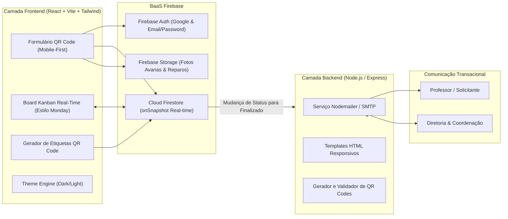

# 🛠️ Especificação de Engenharia de Software
## Sistema Integrado de Gestão de Manutenção Predial e Escolar (SIG-Manu)
*Inspirado no Modelo Operacional SENAI-SP (Norma FR.7.94-36) — Arquitetura Universal SaaS / Multi-Tenant*

---

## 1. Sumário Executivo e Objetivos

O **SIG-Manu** é uma plataforma de missão crítica projetada para digitalizar, acelerar e auditar todo o ciclo de manutenção predial e patrimonial. Nascido a partir dos requisitos e da ficha física **FR.7.94-36** da Escola SENAI de Ourinhos, o sistema foi estruturado com padrão corporativo universal, permitindo aplicação em instituições de ensino, fábricas, condomínios corporativos e complexos hospitalares.

### Objetivos-Chave de Engenharia:
* **Zero Fricção de Acionamento:** Abertura de chamados por leitura de **QR Code** fixado fisicamente nos ambientes (salas, laboratórios, oficinas, sanitários), com pré-carregamento imediato de local e setor.
* **Segurança e Rastreabilidade (Zero Trust):** Autenticação obrigatória (Google / E-mail corporativo) com RBAC (*Role-Based Access Control*) de 3 níveis: Solicitante, Técnico e Gestor.
* **Visualização CRM / Monday:** Painel Kanban com sincronização em tempo real via **Cloud Firestore (`onSnapshot`)**, suportando alocação múltipla de executores, listas de compras de insumos e chat interno auditável.
* **Governança de Validação e Notificação:** Aprovação por 1-clique com credencial do gestor e disparo automático de e-mails formatados para a Direção e para o Solicitante.
* **Experiência Multi-Dispositivo e Alta Acessibilidade:** Interface **Mobile First** (PWA responsivo para técnicos e solicitantes em trânsito) e visão Desktop analítica para a gestão, com alternância de temas **Claro / Escuro**.

---

## 2. Modelagem do Domínio e Entidades (Firestore NoSQL)

### 2.1. Coleção `rooms` (Ambientes & QR Codes)
```json
{
  "id": "sala-01-cnc",
  "codigo": "SL-01",
  "nome": "Laboratório de Usinagem CNC",
  "bloco": "Bloco B",
  "setor": "Mecânica de Precisão",
  "tipo": "Laboratório",
  "qrCodeUrl": "https://manu.senaiourinhos.com.br/abrir?localId=sala-01-cnc",
  "ativo": true,
  "criadoEm": "2026-11-09T22:00:00Z"
}
```

### 2.2. Coleção `tickets` (Ordens de Serviço - Baseadas na FR.7.94-36)
```json
{
  "id": "OS-2026-0042",
  "tipoAtendimento": "INTERNO", // "INTERNO" | "EXTERNO"
  "finalidade": "CORRETIVA", // "PREDITIVA" | "PREVENTIVA" | "CORRETIVA" | "MELHORIA"
  
  // Dados do Solicitante (Preenchimento / Token)
  "solicitante": {
    "uid": "usr_991823",
    "nome": "Prof. Carlos Eduardo Santos",
    "nif": "48912",
    "email": "carlos.santos@sp.senai.br"
  },
  
  // Dados do Ambiente
  "ambiente": {
    "localId": "sala-01-cnc",
    "localNome": "Laboratório de Usinagem CNC",
    "bloco": "Bloco B",
    "setor": "Mecânica de Precisão"
  },
  
  // Descrição do Problema
  "descricao": "Ar-condicionado 24000 BTUs apresentando ruído metálico excessivo e gotejamento de água sobre a bancada 03.",
  "fotosAvaria": [
    "https://storage.googleapis.com/.../ar-vazamento.jpg"
  ],
  
  // Gestão & Kanban (Estilo Monday / CRM)
  "status": "novo", // "novo" | "planejado" | "em_execucao" | "aguardando_material" | "concluido" | "finalizado" | "reprovado"
  "prioridade": "ALTA", // "BAIXA" | "MEDIA" | "ALTA" | "URGENTE"
  
  "planejamento": {
    "dataPlanejada": "2026-11-10",
    "tempoEstimadoHoras": 3.5,
    "atribuidoPor": "gestor_01"
  },
  
  // Técnicos Designados (Múltiplos executores por OS)
  "tecnicosDesignados": [
    { "uid": "tec_332", "nome": "Roberto Silveira", "nif": "33412" },
    { "uid": "tec_881", "nome": "Marcos Oliveira", "nif": "22901" }
  ],
  
  // Gestão de Insumos e Materiais a Comprar
  "materiais": [
    {
      "id": "mat_1",
      "descricao": "Dreno flexível 5/8 pol (3 metros)",
      "quantidade": 1,
      "statusCompra": "COMPRADO", // "SOLICITADO" | "EM_COTACAO" | "COMPRADO" | "DISPONIVEL_ESTOQUE"
      "observacao": "Retirar no almoxarifado central"
    }
  ],
  
  // Apontamento da Execução
  "execucao": {
    "dataInicio": "2026-11-10T08:15:00Z",
    "dataConclusao": "2026-11-10T11:40:00Z",
    "relatoTecnico": "Substituído dreno obstruído e higienizada bandeja de condensado.",
    "fotosConclusao": [
      "https://storage.googleapis.com/.../ar-reparado.jpg"
    ]
  },
  
  // Avaliação & Validação do Gestor (Ficha Oficial)
  "avaliacao": {
    "status": "APROVADO", // "APROVADO" | "PENDENCIAS" | "REPROVADO"
    "observacoes": "Serviço testado com sucesso. Equipamento operando silenciosamente e com drenagem regular.",
    "validadoPor": {
      "uid": "gest_001",
      "nome": "João Paulo Ferreira (Encarregado de Manutenção)",
      "nif": "11234",
      "email": "joao.ferreira@sp.senai.br",
      "validadoEm": "2026-11-10T12:05:00Z"
    }
  },
  
  "notificacao": {
    "emailEnviadoSolicitante": true,
    "emailEnviadoDirecao": true,
    "enviadoEm": "2026-11-10T12:05:30Z",
    "destinatariosDirecao": ["direcao.ourinhos@sp.senai.br", "coordenacao.ourinhos@sp.senai.br"]
  },
  
  "criadoEm": "2026-11-09T22:52:00Z",
  "atualizadoEm": "2026-11-10T12:05:30Z"
}
```

### 2.3. Subcoleção `tickets/{ticketId}/messages` (Chat e Linha do Tempo Interna)
Permite a troca de mensagens, dúvidas sobre o serviço, avisos de chegada de material e alinhamento entre técnicos e gestor.

### 2.4. Coleção `settings/notificationConfig` (Configuração Central de Notificações)
Contém a lista de e-mails da Diretoria/Coordenação que recebem o relatório automático após a homologação de qualquer O.S.

---

## 3. Arquitetura de Software e Tecnologias



---

## 4. Matriz de Permissões (RBAC)

| Funcionalidade | Solicitante (Professor) | Técnico de Manutenção | Gestor / Encarregado |
| :--- | :---: | :---: | :---: |
| Escanear QR Code e abrir chamado | ✅ Sim | ✅ Sim | ✅ Sim |
| Ver seus próprios chamados | ✅ Sim | ✅ Sim | ✅ Sim |
| Visualizar Kanban Geral de Manutenção | ❌ Não | ✅ Sim (Somente Leitura/Ação própria) | ✅ Sim (Acesso Completo) |
| Atribuir / Remanejar Responsáveis | ❌ Não | ❌ Não | ✅ Sim |
| Iniciar Execução e apontar horas | ❌ Não | ✅ Sim | ✅ Sim |
| Adicionar Solicitação de Materiais | ❌ Não | ✅ Sim | ✅ Sim |
| Atualizar Status de Compras de Materiais | ❌ Não | ❌ Não | ✅ Sim |
| Homologar e Aprovar Conclusão da O.S. | ❌ Não | ❌ Não | ✅ Sim |
| Cadastrar Ambientes e Imprimir QR Codes | ❌ Não | ❌ Não | ✅ Sim |
| Gerenciar Lista de E-mails da Diretoria | ❌ Não | ❌ Não | ✅ Sim |

---

## 5. Plano de Implementação em Fases

* **Fase 1: Fundação do Projeto & BaaS**
  - Inicialização com `ag-kit init` e scaffolding da estrutura `/frontend`, `/backend`, `/documentation`.
  - Configuração do Firebase Client e SDK de Admin (Auth, Firestore e Storage).
  - Configuração do Tailwind CSS com suporte a Dark/Light Mode via classe `dark`.

* **Fase 2: Módulo de Ambientes e Gerador de QR Code**
  - Cadastro de Ambientes (Bloco, Setor, Sala/Oficina).
  - Tela de impressão formatada em grade com etiquetas com QR Code, logotipo e identificação.

* **Fase 3: Fluxo do Solicitante (Mobile First)**
  - Reconhecimento automático do parâmetro de URL (`/abrir-chamado?localId=...`).
  - Formulário completo correspondente à ficha FR.7.94-36 com upload de fotos da avaria.

* **Fase 4: Painel Kanban & CRM de Manutenção (Estilo Monday)**
  - Board dinâmico com 6 colunas, drag-and-drop, contadores e filtros por prioridade e setor.
  - Atribuição multi-usuário de técnicos.
  - Módulo integrado de Materiais e Peças a comprar.
  - Chat/Respostas internas por chamado.

* **Fase 5: Módulo de Validação e Notificações por E-mail**
  - Aprovação por 1-clique do Gestor com registro de credencial e parecer técnico.
  - Backend Node.js / Express com Nodemailer disparando e-mail com template visual para o Solicitante e lista de e-mails da Diretoria.

