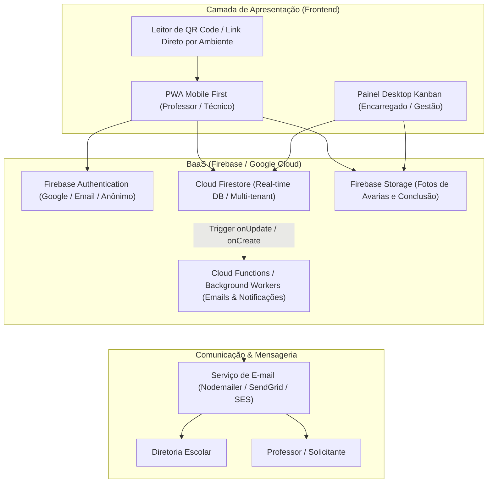

# 📐 Documento de Arquitetura e Engenharia de Software
## Plataforma de Gestão de Manutenção Predial Multi-Ambiente (SaaS / Open Core)

**Autor:** Equipe de Engenharia / Antigravity Expert (SENAI Ourinhos Edition)  
**Versão:** 1.0.0-draft  
**Data:** 09/11/2026  
**Status:** Em Validação (/grill-me)

---

## 1. Visão Executiva e Escopo

Desenvolver uma solução moderna, flexível e em tempo real para controle de solicitações de manutenção predial, baseada no fluxo normativo do SENAI (Ficha de Solicitação de Serviços **FR.7.94-36**), concebida arquiteturalmente de forma **genérica e desacoplada** para permitir implantação em escolas, faculdades, indústrias, condomínios ou hospitais.

### Diferenciais de Engenharia:
1. **Ativação por QR Code:** Cada ambiente (sala, laboratório, oficina, pátio) possui um QR Code único. Ao escanear via smartphone, o solicitante é direcionado a um formulário mobile-first pré-configurado com Local e Setor.
2. **Tempo Real com Firestore:** Atualizações instantâneas de status via WebSockets/Streams (`onSnapshot`), eliminando a necessidade de recarregar a tela.
3. **Fluxo Estilo CRM / Monday:** Kanban dinâmico, atribuição multi-responsável, lista de materiais com status de compras, comentários/chat interno e histórico auditável de eventos.
4. **Ciclo Completo de Governança:** Triagem $\to$ Atribuição $\to$ Execução $\to$ Vistoria e Aceite pelo Gestor $\to$ Disparo automático de relatório aos stakeholders (Diretoria e Solicitante).
5. **Tema Claro / Escuro (High-Contrast):** Otimizado tanto para uso sob luz solar externa quanto para ambientes industriais e salas de aula.

---

## 2. Mapeamento da Ficha SENAI (FR.7.94-36) para o Modelo Digital

| Campo Físico Original | Campo no Sistema Digital | Tipo de Dado | Comportamento Digital |
| :--- | :--- | :--- | :--- |
| **Tipo de Atendimento** | `tipoAtendimento` | Enum: `INTERNO`, `EXTERNO` | Segmentação se é manutenção própria ou terceiro |
| **Nome do Solicitante** | `solicitanteNome` | String | Preenchido via Perfil ou informado no formulário |
| **NIF / Documento** | `solicitanteNif` | String | Identificação funcional (ex: matrícula SENAI) |
| **Descrição do Serviço** | `descricao` | Text + Anexos de Imagens | Descrição + upload de fotos da avaria direto da câmera |
| **Finalidade** | `finalidade` | Enum: `PREDITIVA`, `PREVENTIVA`, `CORRETIVA`, `MELHORIA` | Filtro e categorização operacional |
| **Local / Ambiente** | `localId`, `localNome` | Foreign Key / String | Injetado automaticamente via QR Code |
| **Setor** | `setorId`, `setorNome` | Foreign Key / String | Ex: Mecânica, Informática, Eletroeletrônica, Administrativo |
| **Data Solicitação** | `createdAt` | Timestamp | Timestamp do servidor |
| **Data Planejamento** | `dataPlanejamento` | Date / Range | Definido no Kanban pelo encarregado |
| **Data e Horário Realização** | `execucaoInicio`, `execucaoTermino` | Timestamp | Cronômetro / apontamento real de execução |
| **Responsável pelo Serviço** | `responsaveisIds` | Array<UID> | Permite alocação de 1 ou mais executores |
| **Materiais Necessários** | `materiais` | Array<{item, qtd, statusCompra}> | Módulo de suprimentos integrado à O.S. |
| **Avaliação do Serviço** | `avaliacaoStatus` | Enum: `APROVADO`, `PENDENCIAS`, `REPROVADO` | Vistoria técnica da liderança |
| **Observações** | `observacoesConclusao` | Text | Parecer final do gestor |
| **Assinatura Eletrônica** | `assinaturaDigital` | Canvas / Audit Log com Hash | Registro de conformidade com carimbo de data/hora |

---

## 3. Arquitetura de Software e Tecnologias



---

## 4. Estrutura de Pastas Padronizada

```text
/
├── .env
├── README.md
├── /documentation
│   ├── promptHistory.md
│   ├── arquitetura_projeto.md
│   └── manual_instalacao.md
├── /frontend
│   ├── index.html
│   ├── package.json
│   ├── tailwind.config.js
│   ├── vite.config.ts
│   └── src/
│       ├── assets/
│       ├── components/ (Kanban, Form, QRScanner, Materials, Chat)
│       ├── contexts/ (AuthContext, ThemeContext, RealtimeContext)
│       ├── hooks/
│       ├── layouts/
│       ├── pages/
│       ├── services/ (firebase.ts, notification.ts)
│       └── types/ (ticket.ts, user.ts, room.ts)
└── /backend
    ├── package.json
    ├── functions/ (triggers do Firebase e envio de e-mails)
    └── templates/ (emails transacionais em HTML responsivo)
```

---

## 5. Próximos Passos (Processo /grill-me)
Refinar em conjunto com o usuário as principais decisões de requisitos:
1. Modo de Autenticação para abertura rápida via QR Code.
2. Motor de disparo de e-mails (Cloud Functions vs Backend dedicado).
3. Módulo de catálogo de ambientes e gerador de etiquetas QR Code.

